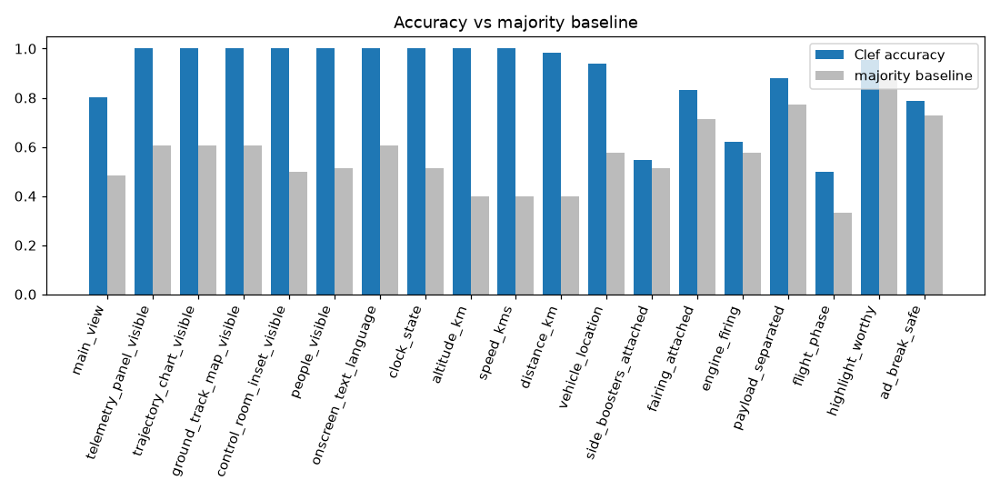
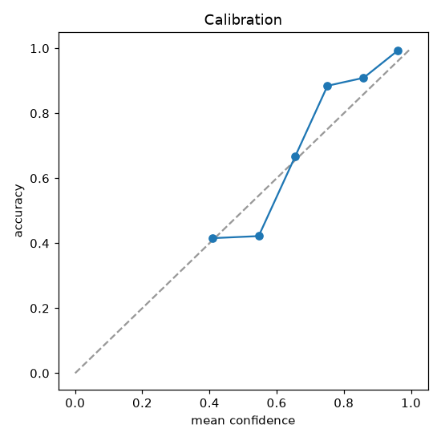

# Accuracy report: run_003

Model `cloudflare/clef`, schema v4, 66 frames, 1251 scored answers.

**About the labels.** The labels were first drafted by Claude (Sonnet) from the frames and then reviewed and corrected by the maintainer. Frames or cells labelled `?` are excluded. `flight_phase` is labelled from the frame alone (no timing inference), the same information Clef gets.

## Summary

| Question | n | Accuracy | Majority baseline | Macro-F1 | Near-miss |
|---|---|---|---|---|---|
| main_view | 66 | 80% | 48% | 0.68 |  |
| telemetry_panel_visible | 66 | 100% | 61% | 1.00 |  |
| trajectory_chart_visible | 66 | 100% | 61% | 1.00 |  |
| ground_track_map_visible | 66 | 100% | 61% | 1.00 |  |
| control_room_inset_visible | 66 | 100% | 50% | 1.00 |  |
| people_visible | 66 | 100% | 52% | 1.00 |  |
| onscreen_text_language | 66 | 100% | 61% | 1.00 |  |
| clock_state | 66 | 100% | 52% | 1.00 |  |
| altitude_km | 65 | 100% | 40% | 1.00 | 0% |
| speed_kms | 65 | 100% | 40% | 1.00 | 0% |
| distance_km | 65 | 98% | 40% | 0.98 | 2% |
| vehicle_location | 66 | 94% | 58% | 0.94 |  |
| side_boosters_attached | 66 | 55% | 52% | 0.54 |  |
| fairing_attached | 66 | 83% | 71% | 0.79 |  |
| engine_firing | 66 | 62% | 58% | 0.60 |  |
| payload_separated | 66 | 88% | 77% | 0.81 |  |
| flight_phase | 66 | 50% | 33% | 0.50 |  |
| highlight_worthy | 66 | 95% | 89% | 0.85 |  |
| ad_break_safe | 66 | 79% | 73% | 0.62 |  |

A question only "works" if Clef clearly beats its majority baseline.

## By group

| Group | Accuracy (pooled) |
|---|---|
| A. Layout | 97% |
| B. Numbers | 100% |
| C. Vehicle | 72% |
| D. Editorial | 87% |

## Confusion matrix: main_view

Rows = label, columns = Clef.

| label \ Clef | live_camera_rocket | animation_rocket | control_room | title_or_graphic_card | other |
|---|---|---|---|---|---|
| live_camera_rocket | 20 | 1 |  | 2 | 1 |
| animation_rocket |  | 32 |  |  |  |
| control_room |  |  | 1 |  |  |
| title_or_graphic_card |  |  |  |  |  |
| other | 7 | 2 |  |  |  |

## Confusion matrix: flight_phase

Rows = label, columns = Clef.

| label \ Clef | pre_launch | liftoff | ascent_with_boosters | ascent_after_booster_sep | ascent_after_fairing_jettison | upper_stage_coast_or_burn | cant_tell |
|---|---|---|---|---|---|---|---|
| pre_launch | 11 |  |  |  |  |  | 1 |
| liftoff | 1 | 1 |  |  |  |  |  |
| ascent_with_boosters |  | 2 | 2 | 18 |  |  |  |
| ascent_after_booster_sep |  |  |  | 11 |  | 2 |  |
| ascent_after_fairing_jettison |  |  |  |  | 3 | 2 |  |
| upper_stage_coast_or_burn |  |  |  |  |  |  |  |
| cant_tell |  |  |  |  | 6 | 1 | 5 |

## Calibration

| Confidence bin | n | Mean confidence | Accuracy |
|---|---|---|---|
| 0.0-0.5 | 77 | 0.41 | 42% |
| 0.5-0.6 | 64 | 0.55 | 42% |
| 0.6-0.7 | 75 | 0.65 | 67% |
| 0.7-0.8 | 104 | 0.75 | 88% |
| 0.8-0.9 | 198 | 0.86 | 91% |
| 0.9-1.0 | 733 | 0.96 | 99% |

## 10 worst frames

| Frame | Wrong answers | Which |
|---|---|---|
| data/frames/f_0063_t315.0.jpg | 6 | main_view (label other, Clef live_camera_rocket); vehicle_location (label not_visible, Clef in_flight); side_boosters_attached (label cant_tell, Clef separated); engine_firing (label cant_tell, Clef no) ... |
| data/frames/f_0059_t295.0.jpg | 5 | main_view (label other, Clef live_camera_rocket); vehicle_location (label not_visible, Clef in_flight); engine_firing (label cant_tell, Clef no); payload_separated (label cant_tell, Clef no) ... |
| data/frames/f_0062_t310.0.jpg | 5 | main_view (label other, Clef live_camera_rocket); side_boosters_attached (label cant_tell, Clef separated); engine_firing (label cant_tell, Clef no); payload_separated (label cant_tell, Clef no) ... |
| data/frames/f_0060_t300.0.jpg | 4 | main_view (label other, Clef live_camera_rocket); engine_firing (label cant_tell, Clef no); payload_separated (label cant_tell, Clef no); flight_phase (label cant_tell, Clef upper_stage_coast_or_burn) |
| data/frames/f_0061_t305.0.jpg | 4 | main_view (label other, Clef live_camera_rocket); engine_firing (label cant_tell, Clef no); payload_separated (label cant_tell, Clef no); flight_phase (label cant_tell, Clef ascent_after_fairing_jettison) |
| data/frames/f_0064_t320.0.jpg | 4 | main_view (label other, Clef live_camera_rocket); engine_firing (label cant_tell, Clef no); payload_separated (label cant_tell, Clef no); flight_phase (label cant_tell, Clef ascent_after_fairing_jettison) |
| data/frames/f_0065_t325.0.jpg | 4 | main_view (label other, Clef live_camera_rocket); side_boosters_attached (label cant_tell, Clef separated); engine_firing (label cant_tell, Clef no); flight_phase (label cant_tell, Clef ascent_after_fairing_jettison) |
| data/frames/f_0018_t090.0.jpg | 4 | side_boosters_attached (label attached, Clef cant_tell); fairing_attached (label attached, Clef cant_tell); flight_phase (label ascent_with_boosters, Clef ascent_after_booster_sep); ad_break_safe (label no, Clef yes) |
| data/frames/f_0019_t095.0.jpg | 4 | side_boosters_attached (label attached, Clef cant_tell); fairing_attached (label attached, Clef cant_tell); flight_phase (label ascent_with_boosters, Clef ascent_after_booster_sep); ad_break_safe (label no, Clef yes) |
| data/frames/f_0030_t150.0.jpg | 4 | side_boosters_attached (label attached, Clef separated); fairing_attached (label attached, Clef jettisoned); engine_firing (label yes, Clef no); flight_phase (label ascent_with_boosters, Clef ascent_after_booster_sep) |

## Cost and latency

- Input tokens, all frames: 190,938
- Cost, all frames: $0.0458 ($0.0083 per minute of video at 5 s sampling)
- Latency: median 1.339 s, p95 1.668 s (measured on frames called in this or an earlier run)

## Event detection

Settings: `min_conf` 0.6, `persist_frames` 2, hit tolerance ±10 s. **4 of 5 true events hit, 1 missed, 1 false positives.**

| Event | True time (s) | Detected at (s) | Outcome | Timing error (s) | False positives |
|---|---|---|---|---|---|
| ignition | 61 | 70 | hit | +9 | 0 |
| liftoff | 65 | 75 | hit | +10 | 0 |
| booster_separation | 203 | 130 | miss |  | 1 |
| fairing_jettison | 268 | 270 | hit | +2 | 0 |
| payload_separation | not in clip | none | correctly absent |  | 0 |
| crossed_100km | 235 | 235 | hit | +0 | 0 |

The event time is the first sampled frame of the new state, so a detection is late by up to one sampling interval, plus any frames skipped because the question had no trusted answer.

`scene_change` (not scored) fired 1 times.

### Sensitivity

Each cell is hits / misses / false positives over the scored events.

| min_conf \ persist_frames | 1 | 2 | 3 |
|---|---|---|---|
| 0.5 | 4 / 1 / 4 | 4 / 1 / 2 | 4 / 1 / 1 |
| 0.6 | 4 / 1 / 1 | 4 / 1 / 1 | 4 / 1 / 1 |
| 0.7 | 4 / 1 / 1 | 4 / 1 / 1 | 4 / 1 / 1 |

Most hits with fewest false positives: `min_conf` 0.6, `persist_frames` 2.
